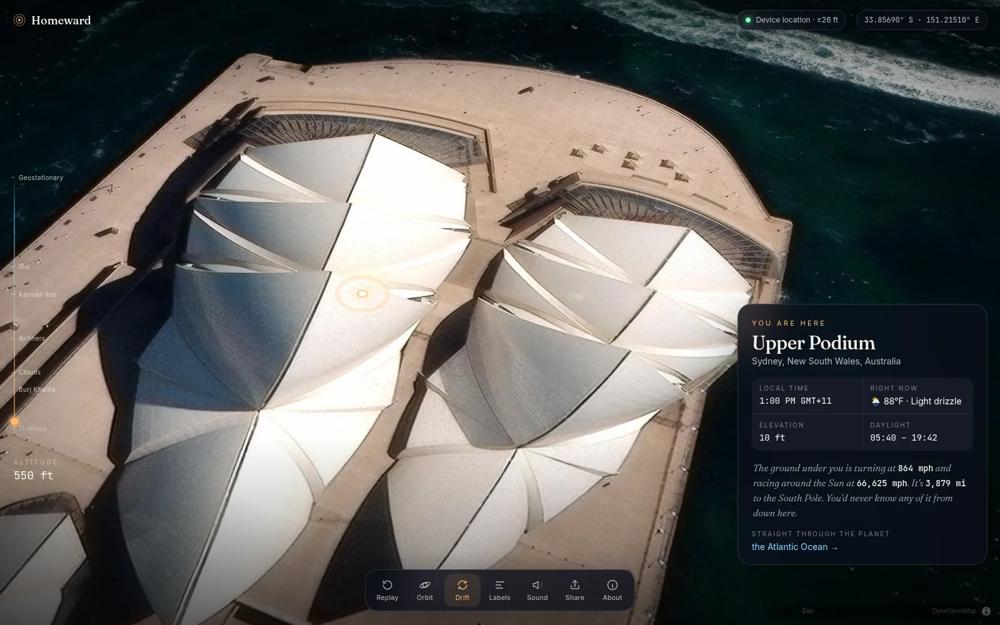
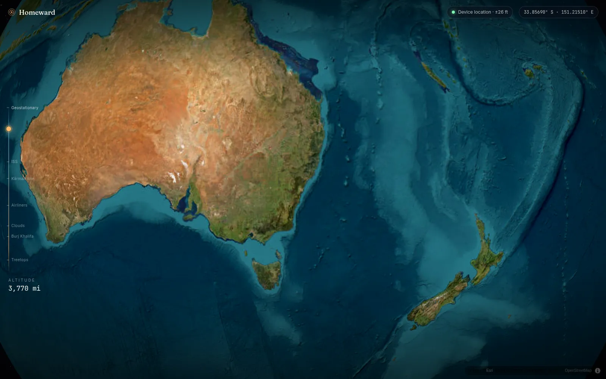

# Homeward

A single, unbroken fall from orbit to the ground beneath your feet.

**Live:** https://homeward.iqapps.space



Open the page and Earth turns slowly in a field of stars. While the title fades,
Homeward works out where you are, turns the planet to face you, and falls. It
passes the geostationary ring, the ISS, the Kármán line, airliners, Everest and
the clouds, and names your country, region, city and neighbourhood on the way
down. It stops at the deepest satellite imagery that exists above your spot.



## Run it locally

It is a static site with no build step and no API keys. Everything that is served lives in `site/`.

```sh
python3 -m http.server 4817 -d site
# open http://localhost:4817
```

Browsers only expose precise device location on `https://` or `localhost`.

## How location works

1. **Time zone** gives an instant rough longitude, so the opening globe already faces your side of the world.
2. **IP geolocation** (ipwho.is, GeoJS, whichever answers first) gives a city-level fix, and the descent starts from that.
3. **Device geolocation** (GPS/Wi-Fi, `enableHighAccuracy`) refines the landing as it improves. If it arrives mid-flight, the camera bends to the new target. If it arrives after landing, the camera glides over.

Homeward never claims more precision than it has. Every fix is classed as a
**spot**, **city**, **region**, **country** or **time zone**, and the landing
stops at that level:

- **Spot** (a device fix within ~300 m, or a shared pin): lands at the deepest available imagery, with a beacon and the neighbourhood name.
- **Area** (IP geolocation, or a coarse device fix): frames the whole uncertainty circle top-down. It shows only names it can vouch for (the city reported by the IP provider, not a street reverse-geocoded from its centroid) and gives the uncertainty in place of the elevation. Share links carry the radius too (`#@lat,lon,~metres`).

If a better fix arrives later, the camera sharpens from the area to the spot.

Imagery depth is probed per location with Esri's `tilemap` service. Where
z20–z23 tiles exist, a detail layer is added and the camera lands that deep.

## Features

- Globe projection with atmosphere, a live day/night terminator that fades through civil and nautical twilight, and a twinkling starfield with parallax
- Logarithmic altimeter with milestone markers and captions
- Cinematic title cards for each level of "where"
- A landing card with local time, weather, elevation, sunrise/sunset, a short note on how fast you're moving, and the antipode (with a fly-there button)
- Share links (`#@lat,lon`) that make the recipient fall to the same exact spot
- Optional generative ambient sound: a pad in orbit, wind through the atmosphere, a chime on landing
- Keyboard: `R` replay · `Esc` orbit · `O` drift · `L` labels · `S` sound
- Respects `prefers-reduced-motion`; responsive down to phone width

## Deployment

Every push to `main` runs [`.github/workflows/build_and_deploy.yml`](.github/workflows/build_and_deploy.yml):

1. **Validate:** checks that the site files exist and that `app.js` parses.
2. **Deploy:** connects to the VPS over SSH and, as the `homeward` user, resets `/srv/apps/homeward` to `origin/main`.

Nginx serves `/srv/apps/homeward/site` over HTTPS with a Let's Encrypt certificate. The config is tracked in [`ops/nginx/homeward.conf`](ops/nginx/homeward.conf).

The workflow needs the repository secrets `SSH_HOST`, `SSH_USER`, `SSH_PORT` and `SSH_KEY`.

## Services used (all keyless, called from the browser)

Esri World Imagery and Reference tiles · OpenStreetMap Nominatim · BigDataCloud
reverse geocoding · Open-Meteo forecast and elevation · ipwho.is / GeoJS ·
MapLibre GL JS 5.6 (unpkg).

## License

[MIT](LICENSE)
